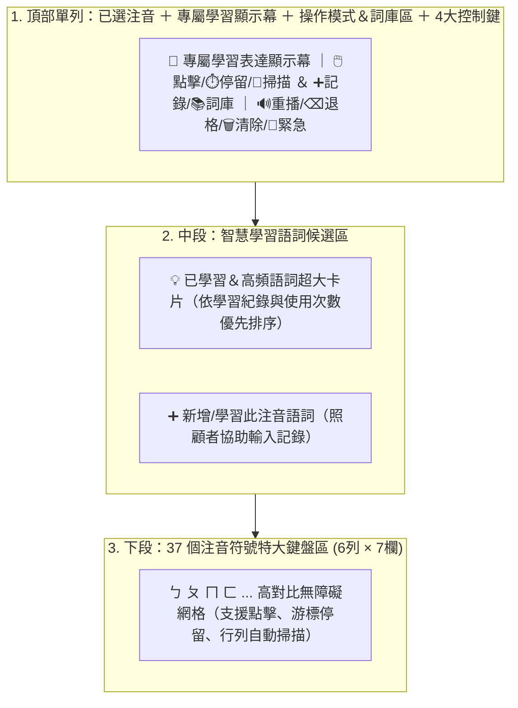

# 注音符號輔助溝通系統 (Bopomofo-AAC) 規劃書

本專案專為**手部無法操作一般鍵盤、且無法言語的病友**設計，透過高對比、特大按鈕的注音符號提示，搭配**多元無障礙選取模式（大按鈕點擊 / 游標停留 / 單鍵行列自動掃描）**與**個人化語詞記憶學習機制**，讓病友能以最少的操作步驟表達需求並自動語音朗讀。

> [!NOTE]
> ### 什麼是 AAC？（專有名詞縮寫說明）
> **AAC** 是醫療復健與語言治療領域的國際通用專有名詞，全稱為 **A**ugmentative and **A**lternative **C**ommunication，台灣通常翻譯為 **「輔助溝通系統」**（或「擴大性與替代性溝通系統」）：
> - **Augmentative（擴大／輔助性）**：協助原本說話不清楚或表達受限的使用者，強化並補充他們的溝通能力。
> - **Alternative（替代性）**：當病友因疾病、插管、氣切或神經肌肉受損而**無法說話、也無法使用雙手打字或書寫**時，用來「替代」口語與紙筆的溝通工具（例如本系統的**注音符號掃描溝通板**、眼動儀溝通版面、語音產生器等）。
> - **Communication（溝通）**：讓病友能自主向家人、護理師或照護者表達生理需求與想法。
>
> 因此 **Bopomofo-AAC** 即代表 **「注音符號輔助溝通系統」**。

---

## 第一階段：首頁鍵盤輸入與顯示畫面規劃

首頁採用**單一畫面無捲軸（100vh / 100dvh 固定螢幕高度滿版高對比配置）**，將視覺焦點分為三大核心區塊，由上而下依序為：

### 1. 頂部：單列整合置頂溝通顯示幕、操作模式與控制列
* **欄位 1（左）：目前已選注音提示欄**：即時顯示病友目前已點選的注音字首組合。
* **欄位 2（中左）：最終表達語詞與專屬學習顯示幕**：當病友從候選區確認語詞（例如「**開燈**」）時，以高對比大字體呈現並同步觸發 **Web Speech API (TTS) 自然語音朗讀**。
* **欄位 3（移至專屬學習區塊右方）：操作模式三按鈕 ＋ 學習詞庫按鈕**：
  * 上排：直接並列 `🖱️ 大按鈕點擊`、`⏱️ 游標停留選`、`🔄 自動掃描` 三個按鈕。
  * 下排：並列 `➕ 記錄新語詞` 與 `📚 詞庫管理`（當切換為停留或掃描模式時，自動顯示秒數下拉選單）。
* **欄位 4（最右）：快速操作 4 大按鈕**：`🔊 再說一次`、`⌫ 退回注音`、`🗑️ 清除重選`、`🔔 緊急呼叫`。

### 2. 中段：即時語詞候選區（最核心的快速表達區）
* **未選注音時（預設狀態）**：直接顯示病友最常使用的置頂日常/緊急語詞與已學習語詞。
* **選取第 1 個注音後（如點選 `ㄎ`）**：
  * 候選區**立即優先列出「已學習」的 `ㄎ` 開頭語詞**（標示 `🌟 已學習` 標籤與使用次數），接著列出內建常用語詞。
* **智慧連續選取與自動切換**：
  * 若繼續點選第 2 個注音且詞庫中有對應的多字首語詞，會自動縮小範圍；若點選的新注音與前一個注音無關，則自動切換為新注音的語詞清單，不需手動按清除鍵。

### 3. 下段：37 個注音符號高對比鍵盤
* **視覺分組與色彩編碼**：
  * **聲母（ㄅ～ㄙ，共 21 個）**：採用沉穩高對比深藍配色。
  * **介音與韻母（ㄧ、ㄨ、ㄩ、ㄚ～ㄦ，共 16 個）**：採用柔和青綠配色，方便視覺快速定位。
* **6 列 × 7 欄固定高度網格**：專為「行列掃描 (Row-Column Scanning)」最佳化，鎖定於 `100vh` 螢幕高度內，確保第 6 列最下排按鍵完整呈現。

---

## 第二階段：語詞記錄與智慧學習功能設計

### 1. 雙軌學習機制
1. **新語詞記錄學習（主動學習）**：
   * 當病友選擇了注音（如 `ㄎ`），但畫面上沒有對應語詞時，點擊 **「➕ 記錄新語詞」**。
   * 系統自動帶入剛才選的注音，照顧者只需輸入國字語詞（例如：`開燈`），系統**內建常用國字轉注音字首字典**，自動建立 `ㄎㄉ` 的索引並標記為 `isLearned: true`（已學習語詞）。
2. **使用習慣強化學習（被動學習）**：
   * 每次病友點選確認任何一個語詞，系統自動記錄該語詞的 `useCount`（累積次數）、`lastUsedAt`（最後使用時間）並設為 `isLearned: true`。
   * **排序演算法**：下次再選同一個注音符號時，已學習與高頻語詞會立即排在第一順位呈現。

### 2. 學習詞庫管理與單檔離線儲存
* 所有程式整合於單一獨立檔案 `index.html`，雙擊即可離線使用。
* 提供「📚 詞庫管理」面板，支援依注音篩選、測試發音、切換星號學習置頂、刪除語詞，以及匯出/匯入 `.json` 詞庫備份檔。
